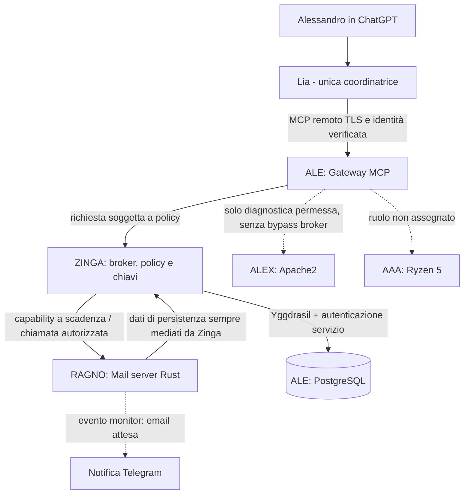

# Architettura a zone di fiducia — proposta Lia

> Proposta tecnica, **non** decisione dell'architetto. Non cambia i ruoli assegnati da Alessandro.

## Identità e responsabilità

| Elemento | Decisione vigente | Confine di fiducia |
| --- | --- | --- |
| Alessandro | Unico architetto e decisore | Approva permessi, azioni sensibili e cambi architetturali |
| Lia / ChatGPT | Unica coordinatrice degli sciami, su richiesta | Non conserva chiavi infrastrutturali né sostituisce il broker |
| ALE | Grande server: MCP remoto + PostgreSQL isolato | Gateway applicativo e persistenza, processi separati |
| ZINGA | Mini PC: broker, chiavi e autorizzazioni | Nessuna scrittura/lettura sensibile senza policy |
| RAGNO | Mini PC: 8 GB RAM, server mail in Rust | Legge/invia posta solo nel perimetro consentito |
| ALEX | Mini PC: Apache2 | Web e reverse proxy, perimetro da confermare |
| AAA | Mini PC Ryzen 5 | **Nessun ruolo deciso** |
| Yggdrasil | Connette tutti i nodi | Rete cifrata ma **non** rete fidata per definizione |

## Diagramma logico

**Interpretazione delle frecce:** descrivono un flusso futuro, non collegamenti già attivi. L'accesso ai dati applicativi della posta, anche quando il gateway MCP e PostgreSQL abitano entrambi su ALE, rimane mediato da ZINGA.

## Zone

- **Z0 — Conversazione utente:** ChatGPT/Lia. Input dell'utente autenticato tramite il connettore e controlli del progetto; le istruzioni nascoste nelle email sono sempre dati non attendibili, mai nuovi comandi di sistema.
- **Z1 — Ingresso MCP:** canale TLS con autenticazione forte, limiti di frequenza e token a durata breve. Cloudflare Tunnel è un possibile trasporto di ingresso HTTPS *se* compatibile con l'autenticazione del connettore ChatGPT; verificare configurazione concreta.
- **Z2 — ALE gateway:** espone solo gli strumenti MCP autorizzati. Niente credenziali DB nel processo MCP e nessuna porta PostgreSQL pubblica.
- **Z3 — ZINGA broker:** policy engine e segreti. Verifica utente, modulo, azione, scopo, autorizzazione, TTL e registra esiti redatti.
- **Z4 — Lavoratori:** RAGNO mail Rust, ALEX Apache2, AAA non assegnato, futuri agenti con permessi isolati; un compromesso non deve permettere un pivot diretto sul DB.
- **Z5 — Dati:** PostgreSQL su ALE, ruolo applicativo per funzione, cifratura dei backup e ripristino testato.
- **ZM — Amministrazione:** SSH solo su percorso di gestione consentito, chiavi forti, privilegi temporanei, canale di recupero fuori banda.

## Trasporti: una funzione per ogni rete

| Componente | Uso proposto | Non usarlo come |
| --- | --- | --- |
| **Yggdrasil** | Trasporto primario interno fra nodi (API/SSH ristretto); `nftables` su IPv6 | Sostituto di firewall o identità applicativa |
| **Cloudflare Tunnel** | Ingresso HTTPS/MCP autorizzato senza pubblicare la porta origin | Tunnel generico per ricezione SMTP su porta 25 |
| **ZeroTier** | Percorso alternativo di manutenzione **disabilitato o ristretto** finché non testato | Seconda rete sempre aperta verso ogni servizio |
| **Tor Onion v3** | Esperimenti con agenti e API minimali isolati, con autenticazione specifica | Motivo per evitare audit, credenziali o limiti di accesso |
| **SSH** | Operazioni amministrative a chiave, da jump/source consentito | Canale universale per far girare comandi agentici non verificati |
| **SIM mobili dedicate** | Backup di connettività/notifiche con profili legali e separati | Identità o autenticazione affidabile; l'anonimato non è un controllo di sicurezza |
| **OpenStack** | Eventuale isolamento e ricostruzione di macchine virtuali **quando** capacità, storage e rete lo permetteranno | Dipendenza necessaria per il servizio mail su 8 GB RAM |

**Importante per la posta:** la consegna SMTP da Internet richiede un MX raggiungibile e un endpoint mail appropriato oppure un relay esterno autorizzato. Cloudflare non proxy SMTP di default: [documentazione](https://developers.cloudflare.com/dns/troubleshooting/email-issues/). Non promettere invisibilità assoluta dell'IP dell'MX. SPF/DKIM/DMARC, relay policy, reputazione IP e backup MX vanno progettati a parte.

## Canali distinti

1. **Control plane:** ChatGPT/Lia → MCP ALE → ZINGA per autorizzazione → agente ammesso.
2. **Data plane:** RAGNO e servizi → ZINGA → PostgreSQL ALE; trasporto su Yggdrasil e autenticazione end-to-end.
3. **Observability plane:** log e eventi filtrati → raccolta su componente ancora da assegnare; nessun segreto e nessun contenuto completo delle email nei log.
4. **Recovery plane:** backup e recupero fuori banda; non deve richiedere che l'intera rete overlay funzioni.

Non imporre Tor, ZeroTier e Cloudflare in serie al traffico normale: aggiungere hop inutili complica diagnosi e continuità. Conservare i confini di fiducia anche in caso di failover.

## Invarianti da provare prima di produzione

- Se **ZINGA è giù**, nessun agente ottiene permessi o accede ai dati con una scorciatoia.
- Se **MCP ALE è giù**, SMTP/monitoraggio locale e ripristino non dipendono dalla chat.
- Se **Yggdrasil cade**, nessuno si apre automaticamente su Internet; eventuale trasporto di emergenza è esplicito e con le stesse policy.
- Se **RAGNO è compromesso**, il suo processo non ha chiavi PostgreSQL e non raggiunge il DB direttamente.
- Se un'email contiene istruzioni rivolte a Lia, sono trattate come testo non fidato.
- Ogni comando di amministrazione e azione distruttiva passa per approvazione esplicita di Alessandro.

## Da decidere solo con Alessandro

- Topologia Yggdrasil, hop consentiti e indirizzamenti.
- Modello di autenticazione di ChatGPT ↔ MCP, mTLS/OAuth, scadenza e revoca dei token.
- Scelta relay/ingresso SMTP, porte pubbliche necessarie e dominio.
- Ruoli futuri, incluso AAA, e collocazione del monitor Telegram.
- Fattibilità tecnica/economica della virtualizzazione OpenStack e della rete Tor.

